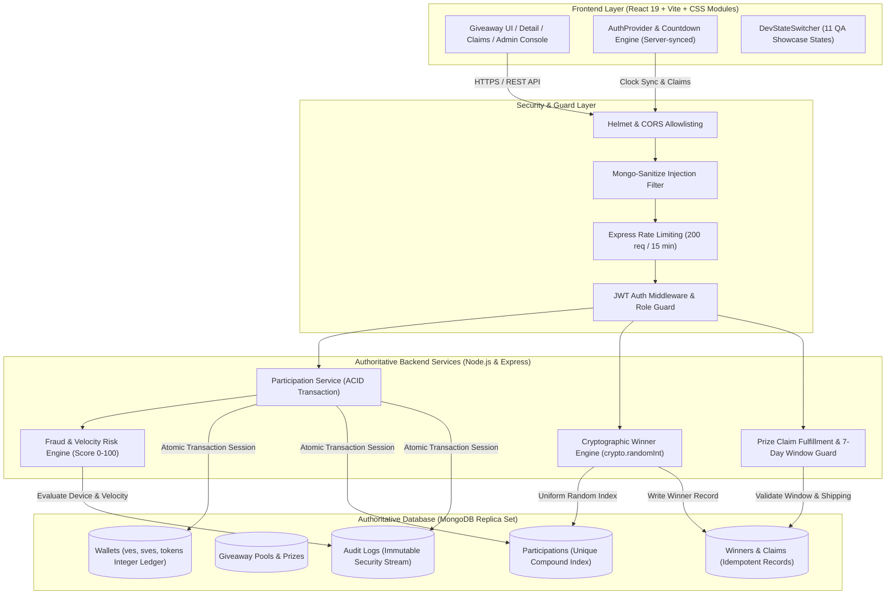

# VELOOP Giveaway & Rewards System

[](https://github.com/Jivan-Patel/VeloopGiveawaySystem/releases/tag/v1.0.0)
[](docs/PRD_CHECKLIST.md)
[](docs/PRD_CHECKLIST.md)

A high-integrity, backend-authoritative reward and giveaway platform engineered for VELOOP. Built with race-condition-proof entry pipelines, atomic integer ledger tracking, server-driven countdown verification, privacy-preserving masked winner IDs, uniform cryptographic winner selection, and zero casino mechanics.

---

## 1. System Architecture



---

## 2. Core Architectural Guarantees

### 2.1 Integer Multi-Currency Ledger (Zero Floating-Point Math)
- All currency calculations use strictly non-negative integers:
  - **VE (Veloop Entries):** Base community currency for standard giveaways.
  - **SVE (Super Veloop Entries):** Premium reward points for high-tier hardware giveaways.
  - **TOKENS:** Promotional/reward platform tokens.
- Balances are validated and atomically decremented inside MongoDB multi-document transactions using atomic operators (`$inc: { "ves": -fee }`) with preconditions (`ves: { $gte: fee }`). Floating-point arithmetic and fractional currency values are disallowed at the schema level.

### 2.2 ACID Multi-Document Transactions
- Concurrent participation submissions run inside isolated MongoDB transactions (`session.withTransaction`).
- A single atomic transaction guarantees:
  1. Authoritative fee verification from database (body fee overrides rejected).
  2. Wallet balance sufficiency check and atomic decrement.
  3. Unique compound index constraint `(giveawayId, userId)` ensuring exactly one ticket per user.
  4. Idempotency key deduplication.
  5. Audit log entry generation.
- If any step fails (e.g., race condition collision or insufficient balance), the entire transaction aborts with zero side effects.

### 2.3 Uniform Cryptographic Winner Selection
- Winner draws use Node.js native `crypto.randomInt(0, participants.length)` to guarantee uniform pseudo-random number distribution over ticket indices.
- Features:
  - **Fisher-Yates Ticket Shuffle:** Eliminates sequential bias.
  - **Atomic Finalization Guard:** Pool transitions to `FINALIZED`; duplicate draw attempts return existing winners idempotently.
  - **Admin Redraw Capability:** Disqualifies a winner violating PRD rules and draws an eligible replacement from remaining tickets.

### 2.4 Prize Claim Workflow & 7-Day Window Enforcement
- Winners have a mandatory 7-calendar-day claim window (`giveaway.endAt + 7 days`).
- Claims submitted after the window closes are strictly rejected (`HTTP 400 CLAIM_EXPIRED`).
- Non-winners attempting claims are rejected (`HTTP 403 NOT_A_WINNER`).
- Duplicate claims are idempotently guarded (`HTTP 409 ALREADY_CLAIMED`).
- PII (shipping address, phone number) is encrypted/protected (`select: false` in database models).

---

## 3. Technology Stack

- **Client**: React 19, Vite, React-Bootstrap & Bootstrap 5 (Modals, Offcanvas, Accordions), CSS Modules (`.module.css`), Lucide Icons, Framer Motion.
- **Design System**: Luxury Obsidian Charcoal (`#0B0E0D`), Refined Emerald Jade (`#10B981`), Natural Titanium (`#E2E8F0`), Champagne Gold (`#F5B83D`). Strictly zero casino animations or neon purple gradients.
- **Backend API**: Node.js, Express, Helmet, CORS allowlisting, Mongo-Sanitize, Zod validation, JWT authentication, Express-Rate-Limit.
- **Database**: MongoDB (Atlas Replica Set for multi-document ACID transactions).
- **Tooling**: Oxlint (0 warnings, 0 errors quality gate).

---

## 4. Project Structure

```
VELOPGiveawaySystem/
├── package.json               # Root monorepo orchestration
├── .gitignore
├── .env.example
├── docs/                      # Comprehensive Documentation
│   └── API.md                 # Complete 16 REST endpoints API specification
├── client/                    # Frontend React application
│   ├── vercel.json            # Vercel SPA rewrites & caching headers
│   ├── src/
│   │   ├── components/        # Isolated UI components with CSS Modules
│   │   │   ├── Banner/        # Reusable GiveawayBanner
│   │   │   ├── Claims/        # PrizeClaimModal & tracking details
│   │   │   ├── DevStateSwitcher/ # 1-click QA state flipper (11 visual states)
│   │   │   ├── Hero/          # Hero banner with restrained motion
│   │   │   ├── Loader/        # ThemedLoader with status indicators
│   │   │   ├── Navbar.jsx     # Navigation bar with responsive drawer & admin link
│   │   │   └── Footer.jsx     # Compliance footer with audit badge
│   │   ├── config/            # Currencies, prize types, status enum constants
│   │   ├── data/              # Authoritative mock JSON contract & scenarios
│   │   ├── hooks/             # useCountdown, useGiveaways, useAuth
│   │   ├── pages/             # Giveaway, GiveawayDetail, Admin, Login, SignUp, Earn
│   │   ├── services/          # giveawayApi, liveAdapter, mockAdapter
│   │   └── styles/            # Design tokens (variables.css, global layout)
│   └── public/assets/prizes/  # High-resolution copyright-free photography
└── server/                    # Authoritative Backend Express API
    ├── render.yaml            # Render Web Service deploy specification
    ├── Procfile               # Cloud process execution file
    ├── src/
    │   ├── app.js             # Security middleware, healthchecks, route mounting
    │   ├── server.js          # Server entry point & connection bootstrap
    │   ├── models/            # Mongoose schemas (Giveaway, Wallet, Claim, AuditLog)
    │   ├── routes/            # auth.js, giveaways.js, admin.js
    │   └── services/          # participationService, winnerService, claimService, fraudEngine
    └── test/                  # Automated In-Memory Test Suites
        ├── raceCondition.test.js      # 20-parallel race condition ledger validation
        ├── fraudRisk.test.js          # Device velocity & fraud scoring validation
        ├── securityAndClaims.test.js  # Tamper, replay & claim window validation
        └── winnerAndClaim.test.js     # Crypto random draw & prize claim validation
```

---

## 5. Getting Started

### Prerequisites
- Node.js >= v20.x
- npm >= 10.x

### 1. Installation
Install root, client, and server dependencies:
```bash
npm --prefix client install
npm --prefix server install
```

### 2. Environment Configuration
Copy environment templates:
```bash
cp .env.example .env
cp client/.env.example client/.env
cp server/.env.example server/.env
```

### 3. Run Locally
```bash
# Start Client (Vite Dev Server on http://localhost:5173)
npm run dev:client

# Start Backend API (Express on http://localhost:5000)
npm run dev:server
```

---

## 6. Automated Test Suites & Verification

The test suite runs against real multi-document ACID transactions using `mongodb-memory-server` replica sets.

Execute all automated verification suites:
```bash
npm --prefix server test
```

### Test Suite Coverage:
1. **Race Condition Test (`raceCondition.test.js`):**
   - Fires 20 simultaneous parallel join requests from a single user.
   - Verifies exactly 1 request succeeds (HTTP 200) and 19 fail (HTTP 409).
   - Confirms wallet balance was decremented exactly once with zero currency leakage.
2. **Fraud Risk Engine Test (`fraudRisk.test.js`):**
   - Simulates device velocity abuse and duplicate fingerprint collisions.
   - Verifies blocking with HTTP 403 `PARTICIPATION_BLOCKED` and audit logging.
3. **Security, Tamper & Claim Window Test (`securityAndClaims.test.js`):**
   - Validates unauthenticated request rejection (HTTP 401).
   - Validates payload fee tampering rejection (authoritative DB fee enforced).
   - Validates non-winner claim rejection (HTTP 403).
   - Validates duplicate claim rejection (HTTP 409).
   - Validates claim submission after 7-day expiration rejection (HTTP 400).
4. **Winner Selection & Redraw Test (`winnerAndClaim.test.js`):**
   - Verifies `crypto.randomInt` uniform distribution.
   - Verifies finalization idempotency.
   - Verifies administrative winner redraw upon participant disqualification.

---

## 7. QA Showcase & 11 Visual Demo States

The platform features an embedded **Dev State Switcher** widget (visible in development or by appending `?demo=1` to any URL) that enables instant switching between all 11 PRD visual presentation states:

| State # | Presentation State | Trigger / Description |
| :---: | :--- | :--- |
| **1** | **Active Giveaway (Logged Out)** | Guest visitor view; "Sign In to Enter" CTA button. |
| **2** | **Active Giveaway (Sufficient VE)** | Logged-in user with 2,500 VE; 1-click "Enter Giveaway" enabled. |
| **3** | **Active Giveaway (Low VE Balance)** | User has 40 VE (fee is 250 VE); primary CTA redirects to "Earn More VE". |
| **4** | **Active Giveaway (Low SVE Balance)**| User has 20 SVE; fee requires 50 SVE; displays SVE earning instructions. |
| **5** | **User Already Entered** | User has already joined; shows "Entered" badge with ticket number. |
| **6** | **Upcoming Giveaway** | Scheduled campaign; countdown displays time until start; disabled join CTA. |
| **7** | **Ended Giveaway (Selecting Winners)** | Pool ended; live pulse indicator showing cryptographic draw in progress. |
| **8** | **Ended Giveaway (Winner - Unclaimed)**| Current user won; displays prize banner with "Claim Prize" button. |
| **9** | **Ended Giveaway (Winner - Physical Claim)** | Shows physical address form with PIN code & carrier validation. |
| **10** | **Ended Giveaway (Winner - Digital Claim)**| Shows digital gift card voucher claiming with email/phone verification. |
| **11** | **Ended Giveaway (Winner - Dispatched)** | Claim fulfilled; displays courier partner (BlueDart) and live tracking number. |

---

## 8. Deployment Specifications

- **Client**: Configured for Vercel deployment with SPA rewrites and asset caching in `client/vercel.json`.
- **API**: Configured for Render deployment in `server/render.yaml` with continuous health monitoring at `/health`.
- **Health Endpoint**: `GET /health` returns JSON reporting service status, version, uptime in seconds, and database connection state:
```json
{
  "status": "ok",
  "service": "veloop-giveaway-api",
  "version": "1.0.0",
  "uptimeSeconds": 14520,
  "timestamp": "2026-11-10T16:15:45.000Z",
  "database": {
    "status": "connected",
    "readyState": 1
  }
}
```

---

## 9. Quality Gates & Linter Compliance

- **Oxlint**: 0 errors, 0 warnings.
- **Production Build**: Vite bundle optimization transforms 2,000+ modules with 0 errors.
